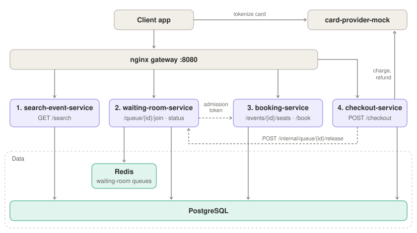

# Jeeves (Go)

An events booking system. Users find an event, pick a seat, hold it for a few minutes and pay for it. Events with high demand put users through a **waiting room** first, which lets them in at a controlled pace.

## Architecture



### Components

| Component | Role |
|---|---|
| Gateway (nginx) | Single entry point. Routes each path to its service and applies per-user rate limits. |
| search-event-service | Searches the catalog by event name and returns each event with its venue and seat counts, not the seats themselves. |
| waiting-room-service | Queues users for high-demand events, admits them at a controlled pace and gives each admitted user an admission token. |
| booking-service | Shows an event's seat map and puts timed holds on seats. For queued events, both require an admission token. |
| checkout-service | Charges the card for a held seat, marks it sold, and frees the buyer's place in the waiting room. |
| Card provider (mock) | Stands in for a payment provider: turns card details into a token, charges and refunds. Card data never reaches our services. |
| Postgres | The single source of truth for users, venues, events, tickets and payments, shared by every service. |
| Redis | Holds only the waiting-room queues. Nothing is cached. |

Search is public. Every other endpoint takes the user from the `X-User-Id` header (see Known limitations). Each service is its own Go module with a hexagonal layout: `internal/core` (domain, ports, service) and `internal/adapters` (REST in, Postgres/Redis/HTTP out).

### Data modeling

| Table | Schema | Description |
|---|---|---|
| users | `id` PK, `name`, `email` (unique) | Who can book and buy |
| venues | `id` PK, `name`, `size` | Where events happen |
| events | `id` PK, `name`, `date`, `venue_id` → venues, `ticket_ids` (uuid[]), `queue_enabled`, `admit_rate_per_sec`, `max_active_users` | Name, date and venue; the list of its tickets; whether it uses the waiting room, and its admission limits |
| tickets | `id` PK, `seat_number`, `type`, `price_cents`, `status`, `booked_by` → users, `booked_at`, `hold_expires_at`, `sold_at` | One per seat: number, type (`general`/`vip`), price and status (`available`, `booked` or `sold`), the owner (if any) and the expiration of the booking (if any)|
| payments | `id` PK, `ticket_id` → tickets, `user_id` → users, `amount_cents`, `status`, `provider_charge_id`, `idempotency_key` (unique), `created_at`, `updated_at` | One per checkout attempt, keyed by its idempotency key, with its outcome and the provider's charge id |

A held seat whose hold/booking has expired counts as available again, with no background job.

## User flow

1. **Find the event.** `GET /search?name=…` (search-event-service) returns matching events with their seat counts and whether they're queued. Search is always open, including for users waiting in a queue.
2. **Wait in line**, only for queued events (waiting-room-service).
   - `POST /queue/{eventId}/join` gives the user a position; joining again keeps it.
   - `GET /queue/{eventId}/status` returns the position, how many are ahead and an estimated wait, until the user is admitted with an **admission token** valid for 15 minutes.
   - Users are let in at the event's rate while it has room: at most `max_active_users` at once, and at most 2 per seat still on sale. A place frees up when its user buys a ticket or their 15 minutes run out.
   - Once every ticket is sold, the queue closes and tells everyone waiting.
3. **See the seats.** `GET /events/{id}/seats` (booking-service) returns every seat with its current status. Queued events need the admission token.
4. **Hold a seat.** `POST /book {ticketId}` (booking-service) holds the seat for 10 minutes. A seat can only be held by one user, and a user can hold at most 4 seats per event. Queued events need the admission token.
5. **Tokenize the card.** The client sends the card to the provider (`POST :9090/tokens`) and gets a payment token back.
6. **Check out.** `POST /checkout {ticketId, paymentToken}` with an `Idempotency-Key` header (checkout-service) charges the card, marks the seat sold and frees the user's waiting-room place. Retrying with the same key returns the first outcome instead of charging again. A declined card leaves the hold in place for another try. If the provider doesn't answer, the payment stays `pending` (see [Edge case: `pending` payments](#edge-case-pending-payments)).

## Replicas

booking-service and waiting-room-service run 2 replicas each (`deploy.replicas` in `docker-compose.yml`), and the gateway spreads requests across them, to help verify the concurrency and contention scenarios:
- two users racing for the same seat on different instances still produce a single hold
- a user's hold limit holds when their requests land on different instances
- both waiting rooms run the admitter, but users are still let in at the event's rate

## Edge case: `pending` payments

When the card provider times out or answers with a 5xx, checkout can't tell whether the card was charged. The payment stays `pending` and we return an error. The payment isn't marked failed, because that would invite a retry with a new key that could charge the card twice. The hold then could expire and another user could buy the seat, without us knowing if the first charge succeeded. Alternatives to a consistent flow could be:

### Option A: a reconciler

A background worker, in checkout-service or a service of its own, periodically picks up `pending` payments that no request is still working on, asks the provider what happened to each charge, and then sells the ticket, refunds the charge, or marks the payment failed.

- **Pros:** settles every unknown outcome, including a crash mid-checkout, and works with any provider that can look up a charge.
- **Cons:** one more always-running process to operate; the seat may be resold before it runs, so some cases end in a refund; the provider needs a charge-lookup endpoint.

### Option B: authorize, then capture, expiring with the hold

The charge is split in two. Checkout first authorizes the card, which holds the money until the seat's hold expires, then marks the seat sold and captures the money. If the authorization's outcome is unknown, the provider releases the money when the hold expires, at the same moment the seat goes back on sale.

- **Pros:** nothing to run on our side, and the customer is never charged for a seat they didn't get.
- **Cons:** shifting responsibility or requirements to the provider; every purchase takes two provider calls.

## Known limitations

- Users aren't authenticated: requests name their user in the `X-User-Id` header and nothing checks it. A real implementation would use a JWT token to identify the incoming user (in booking-service, checkout-service and waiting-room-service).
- Nothing is cached: every search and seat map reads Postgres.
- Seat maps return every ticket as JSON, which suits venues up to a few thousand seats. Past roughly 5–10k seats, or with many users viewing at once, move to a static layout plus a per-event availability bitmap.
- `events.ticket_ids` can't have foreign keys. Postgres doesn't enforce that each id points to a real ticket, that a ticket belongs to a single event, or that seat numbers are unique per event.
- Waiting room:
    - ordering is first come, first served, with no randomized lobby before the sale opens;
    - admission adapts to free slots and seats left, not to backend health such as latency or errors;
    - a user who leaves without buying keeps their slot until the admission expires, because activity isn't tracked;
    - the release endpoint has no authentication; it relies on not being routed by the gateway;
    - Redis isn't persisted, so a restart empties every queue.

## Scalability and reliability

As every service is stateless, horizontal scaling in the main strategy to tackle scalability.

- **Postgres:** every copy of every service keeps its own connections to the database, so adding copies eventually exhaust the available connections. A connection pooler in front of Postgres lets many copies share a small number of connections. The database is also a single point of failure: production would run a standby that takes over automatically, and send read-only traffic such as search to read replicas, keeping bookings and payments on the main database.
- **Redis:** it holds every queue and answers every status check, so it carries the load of everyone waiting. Saving its data to disk and running a standby keeps the queues alive through a restart or failure. When one node isn't enough, events can be spread across several Redis nodes, since each event's queue is independent. Pushing status updates to clients, instead of having them ask every few seconds, reduces the load further.
- **Notifications:** confirmations are queued in memory, so they're lost if the queue fills up or the service stops. Recording each notification in the database together with the booking, and sending it from a separate process that retries until it succeeds, makes sure none are lost.

## Run

Requires only Docker and `make`: the demos and the tests also run in containers. Start the stack:

```bash
make up
```

### Demo

Import [`postman/jeeves.postman_collection.json`](postman/jeeves.postman_collection.json) into Postman and run its folders in order, or run them all from the terminal (newman runs in Docker):

```bash
make demo
```

It walks the user journey: buying a seat for an open event, the same through the waiting room, and a declined card. See [postman/README.md](postman/README.md).

To watch the waiting room at work, run a live terminal view: 10 bots queue ahead of you, get in a few at a time and buy their seats, while your place advances until you get in and buy yours:

```bash
make demo-queue
```

It creates its own event and users and deletes them at the end. `make demo-queue ARGS="--bots 40 --places 5"` changes the crowd; `--help` lists the options.

The seed has three users (Ada `1111…`, Alan `2222…`, Grace `3333…`) and four events with 8 seats each. "Rock en el Parque" uses the waiting room. For your own requests, send a user's id in the `X-User-Id` header. Test cards: `4242424242424242` approves, `4000000000000002` declines.

### Tests

```bash
make integration-test
```

See [integration-tests/README.md](integration-tests/README.md).

### Other targets

- `make down` stops everything and cleans up: containers, the database and every image built for the project. The next `make up` rebuilds from scratch;
- `make reset` only drops the database, so the seed is applied again on the next `make up`;
- `make logs` follows every service's logs;
- `make build` builds and vets every Go module.

Config: copy `.env.example` to `.env` to override secrets, TTLs and limits. Postgres is on `localhost:5433` (user, password and database `jeeves`).

## Use of AI

Jeeves was built together with an AI coding assistant, Claude Code. The work started from a clear design: the services and their responsibilities, the data model, the user flow and the rules that must always hold (one hold per seat, one charge per payment, a controlled admission pace). 
From there it was the usual cycle of review and improvement. Each change was run against the real stack, checked with the integration tests and the demos, and revisited when something didn't hold up. The design changed along the way as a result: the waiting room went from a fixed admission rate to one that adapts to free places and seats left, the catalog search and the seat map were split between services, the payment reconciler was dropped in favor of documenting the options, and user authentication was simplified to a header. Testing also caught real problems, such as admission ticks being lost across replicas and a demo that started before the services were ready, which were fixed and covered.

## Video explanation

Unlisted YouTube link: https://www.youtube.com/watch?v=y8VQUPaF5JI